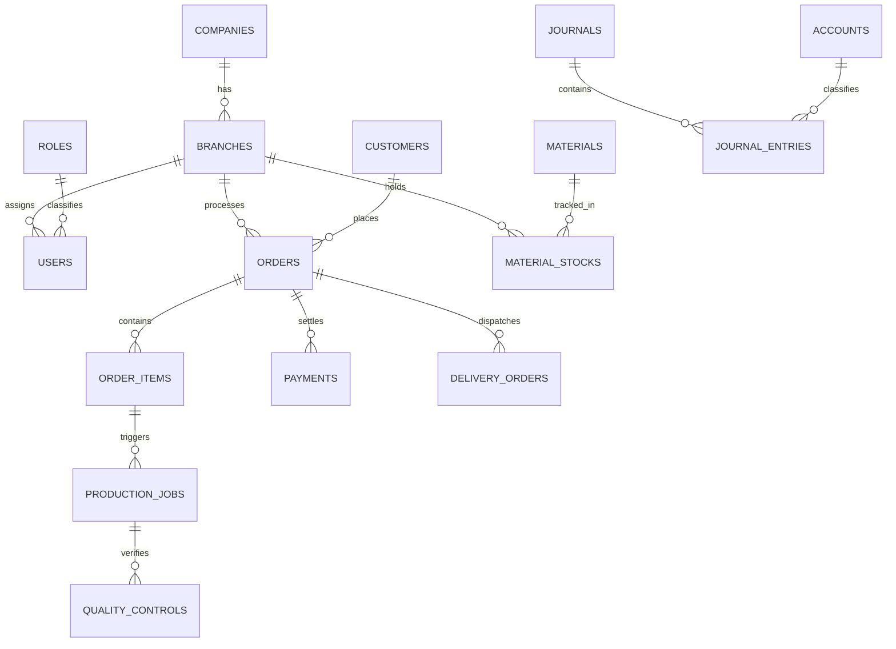

# PRINTMASTER – Skema Database & Kamus Data

Dokumen ini mendokumentasikan skema database relasional **PRINTMASTER**, mencakup 62 tabel InnoDB terstruktur, indeks, relasi foreign key, dan diagram relasi entitas (ERD).

---

## 1. Spesifikasi Teknis Database

- **Database Engine**: MariaDB 10.5+ / MySQL 8.0+ / MySQL 5.7
- **Storage Engine**: `InnoDB` (mendukung penuh ACID, row-level locking, dan foreign key constraints)
- **Karakter Set & Collation**: `utf8mb4` / `utf8mb4_unicode_ci` (mendukung emoji, nama internasional, dan simbol khusus)
- **Zona Waktu Server**: `+07:00` (WIB / Asia/Jakarta)
- **Lokasi Berkas SQL**:
  - Skema Lengkap: [`database/printmaster.sql`](file:///home/antigravity/database/printmaster.sql)
  - Data Awal (Seeds): [`database/seeds/initial_seeds.sql`](file:///home/antigravity/database/seeds/initial_seeds.sql)

---

## 2. Pengelompokan 62 Tabel Berdasarkan Domain Bisnis

### A. Perusahaan, Multi-Cabang & Hak Akses (RBAC)
1. `companies`: Data profil perusahaan induk (nama, logo, NPWP, alamat kantor pusat).
2. `branches`: Cabang-cabang percetakan (kode unik, nama, alamat, telepon, status kantor pusat).
3. `roles`: Daftar jabatan/peran (superadmin, owner, branch_manager, cashier, designer, operator, qc, warehouse, purchasing, accountant, hrd, courier, customer).
4. `permissions`: Daftar izin aksi granular (misal: `orders.create`, `cash_shift.manage`, `accounting.post`).
5. `role_permissions`: Pemetaan relasi many-to-many hak akses per role.
6. `users`: Akun pengguna sistem dengan `password_hash` standar bcrypt.
7. `user_branches`: Pemetaan cabang yang diizinkan untuk dikelola oleh setiap user.
8. `audit_logs`: Rekam jejak seluruh aktivitas penting (siapa, kapan, aksi apa, IP address, data sebelum/sesudah).
9. `login_attempts`: Pencatatan log autentikasi guna pencegahan brute-force.

### B. Pelanggan & CRM
10. `customers`: Master data pelanggan dengan klasifikasi tier (`regular`, `member`, `reseller`, `corporate`), limit piutang, dan diskon.
11. `customer_addresses`: Buku alamat pengiriman pelanggan.
12. `customer_reviews`: Catatan ulasan dan tingkat kepuasan pelanggan terhadap hasil cetak.

### C. Katalog Produk, Material & Finishing
13. `product_categories`: Kategori produk (Digital Printing, Offset, Merchandise, Outdoor, Large Format).
14. `products`: Master produk cetak dengan jenis penentuan harga (`unit`, `area`, `length`, `volume`).
15. `product_prices`: Tabel harga bertingkat berdasarkan kuantitas atau tier pelanggan.
16. `product_materials`: Resep kebutuhan bahan baku untuk setiap jenis produk.
17. `finishing_options`: Pilihan finishing (Laminasi Doff/Glossy, Pond, UV Varnish, Jilid Baut, Eyelet).
18. `product_finishings`: Relasi produk dengan opsi finishing yang kompatibel.
19. `pricing_formulas`: Aturan kalkulator estimasi biaya dan margin keuntungan.

### D. Penjualan, Kasir POS & Penawaran
20. `orders`: Master transaksi penjualan (nomor pesanan, cabang, pelanggan, total tagihan, jumlah bayar, sisa piutang, status).
21. `order_items`: Rincian item pesanan (produk, ukuran panjang x lebar, jumlah, harga satuan, subtotal).
22. `order_item_finishings`: Finishing yang diaplikasikan pada setiap item pesanan.
23. `order_status_history`: Catatan kronologis perubahan status pesanan.
24. `quotations`: Dokumen penawaran harga resmi (surat penawaran sebelum menjadi order).
25. `quotation_items`: Rincian item dalam dokumen penawaran harga.

### E. File Desain & Proofing
26. `design_jobs`: Antrean penugasan desain grafis kepada desainer cabang.
27. `design_files`: Berkas kerja desain, pratinjau thumbnail, dan berkas siap cetak (ready to print).
28. `design_revisions`: Catatan permintaan revisi dari pelanggan atau operator.

### F. Manajemen Produksi, Mesin & QC
29. `production_jobs`: Surat Perintah Kerja (SPK) untuk lantai produksi dengan nomor SPK unik.
30. `production_job_logs`: Riwayat pengerjaan SPK (operator, mesin yang digunakan, waktu mulai, selesai).
31. `machines`: Master mesin percetakan (jenis cetak, kapasitas kecepatan, status operasional).
32. `machine_maintenance`: Log pemeliharaan berkala, servis teknisi, dan penggantian sparepart mesin.
33. `quality_controls`: Pemeriksaan hasil cetak sebelum pengemasan (lolos atau tolak).
34. `reprint_tickets`: Tiket cetak ulang apabila terjadi kesalahan produksi atau cacat bahan.
35. `reprint_items`: Item dan alasan yang harus dicetak ulang.

### G. Persediaan Gudang & Bahan Baku
36. `material_categories`: Kategori bahan baku (Kertas/Art Paper, Stiker/Vinyl, Tinta, Plat, Akrilik).
37. `materials`: Master bahan mentah dengan satuan terkecil dan ambang batas minimum (safety stock).
38. `warehouses`: Daftar gudang penyimpanan per cabang.
39. `material_stocks`: Posisi saldo kuantitas stok bahan pada masing-masing gudang cabang.
40. `stock_movements`: Kartu stok lengkap mencatat mutasi masuk, keluar, penyesuaian, dan pemakaian SPK.
41. `stock_transfers`: Dokumen transfer stok bahan antar-cabang (cabang asal ke cabang tujuan).
42. `stock_transfer_items`: Rincian bahan dan kuantitas dalam dokumen transfer stok.

### H. Pembelian & Pemasok (Purchasing)
43. `suppliers`: Master data vendor pemasok bahan baku percetakan.
44. `purchase_orders`: Dokumen Purchase Order (PO) pembelian bahan ke supplier.
45. `purchase_order_items`: Rincian bahan dan harga beli pada PO.
46. `purchase_receives`: Bukti penerimaan barang fisik di gudang cabang (GRN).

### I. Keuangan, Kas, Biaya & Jurnal Akuntansi
47. `accounts`: Bagan Akun Standar / Chart of Accounts (COA) untuk akuntansi berpasangan.
48. `cash_registers`: Master laci kasir (POS terminal) per cabang.
49. `cash_shifts`: Manajemen shift kasir (saldo modal awal, total tunai, saldo penutupan).
50. `cash_shift_logs`: Rincian transaksi penerimaan dan pengeluaran selama shift aktif.
51. `payments`: Pencatatan pembayaran transaksi pesanan (kas, transfer bank, QRIS, uang muka).
52. `expenses`: Pencatatan kas keluar operasional cabang (listrik, konsumsi, bensin, perlengkapan).
53. `journals`: Buku Jurnal Umum transaksi finansial dengan nomor referensi unik.
54. `journal_entries`: Entitas debit dan kredit yang wajib seimbang ($Debit = Kredit$).

### J. SDM, Logistik, Pemasaran & WhatsApp
55. `employees`: Master data karyawan, jabatan, tanggal masuk, dan gaji pokok.
56. `attendance`: Rekap presensi harian karyawan (jam masuk, jam keluar, status kehadiran).
57. `payrolls`: Slip gaji bulanan karyawan beserta rincian tunjangan dan potongan.
58. `delivery_orders`: Surat jalan pengiriman pesanan ke pelanggan atau pengambilan di toko.
59. `promotions`: Master kode voucher diskon dan periode promosi pemasaran.
60. `promotion_usages`: Rekam pemakaian kupon diskon oleh pelanggan.
61. `whatsapp_templates`: Templat pesan notifikasi WhatsApp resmi (pesanan masuk, SPK selesai, pelunasan).
62. `whatsapp_logs`: Riwayat antrean pengiriman pesan WhatsApp beserta status keterkirimannya.

---

## 3. Diagram Relasi Entitas Inti (Mermaid ERD)

---

## 4. Mekanisme Jurnal Akuntansi Otomatis

Setiap kali transaksi penting terjadi, `AccountingService` memposting jurnal double-entry otomatis:

1. **Penerimaan Pembayaran Kasir POS**:
   - `Debit`: Akun Kas Kasir (1111) / Bank Transfer (1112)
   - `Kredit`: Pendapatan Penjualan Cetak (4101) / Uang Muka Pelanggan (2102)

2. **Pengeluaran Biaya Operasional**:
   - `Debit`: Beban Operasional Terkait (6xxx)
   - `Kredit`: Akun Kas / Bank (111x)

3. **Penerimaan Pembelian Bahan (PO)**:
   - `Debit`: Persediaan Bahan Baku (1131)
   - `Kredit`: Utang Usaha ke Pemasok (2101)
